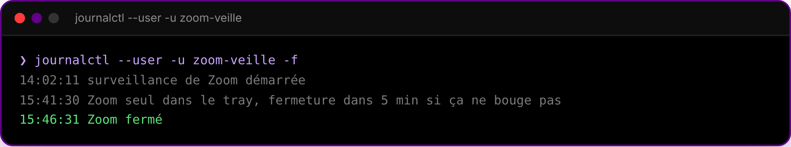

<p align="center"></p>

<p align="center">  </p>

<p align="center"><a href="README.fr.md">🇫🇷 Version française</a></p>

**Automatically closes Zoom when it's sitting idle in the system tray.**

The Linux Zoom client uses 2–10 % CPU even when minimized to the tray, which hurts laptop battery life. This small user service closes it after 5 minutes of real inactivity.

## When Zoom gets closed

Only if, for 5 minutes in a row:

- no Zoom window exists (even minimized — a minimized waiting room is safe);
- no Zoom audio stream is active in PipeWire;
- the camera isn't open by Zoom.

You get a "Zoom closed" notification. If KWin doesn't answer, nothing is closed.

<p align="center"></p>

No X11 on Wayland, so it lists windows through KWin's KRunner "windows" runner over D-Bus, then `getWindowInfo` to check each window class (a browser tab titled "Zoom pricing" doesn't count).

## Install

```bash
git clone https://github.com/glime32/zoom-veille && cd zoom-veille && ./install.sh
```

Settings (`DELAI`, `PAS`) at the top of `zoom-veille.py`. Disable with `systemctl --user disable --now zoom-veille.service`.

When Zoom isn't running, the script only reads `/proc` every 30 s: 0 % CPU, ~10 MB RAM.
